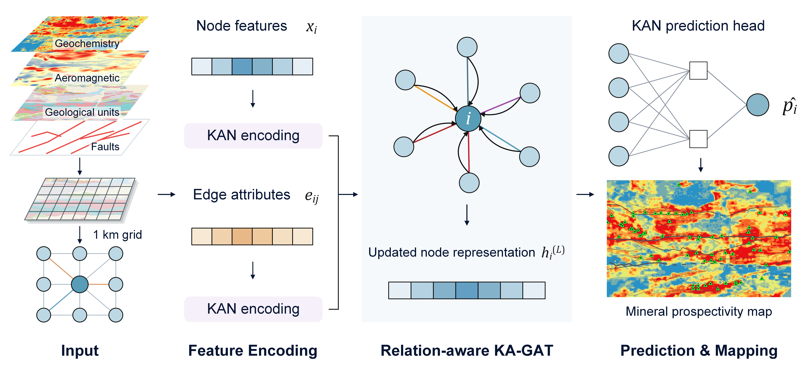
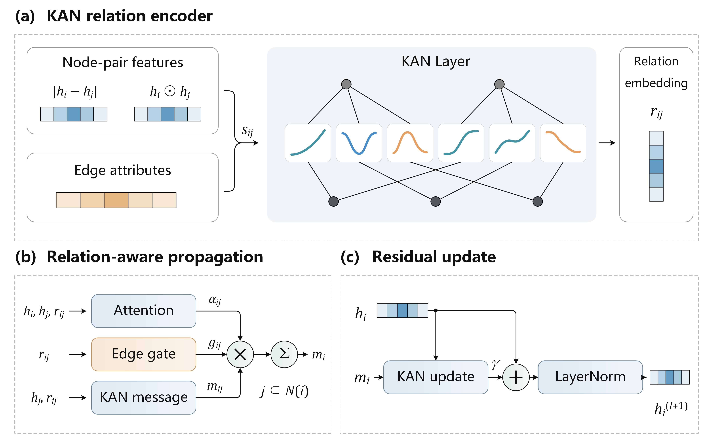

# GeoKA-GNN for Mineral Prospectivity Mapping

[简体中文](README.zh-CN.md)

Public method code for confidential geoscience inputs: assay preprocessing,
center-grouped three-fold cross-validation, radius graphs, and GeoKA-GNN with
**distance, along-fault, cross-fault and same-igneous-body** relations. Data owners
supply their own local inputs. Original research datasets, sample coordinate
tables, fitted weights and numerical experiment outputs are not distributed.

## Model architecture

**Overall framework.** Multi-source geoscience features and spatial/geological
relations feed GeoKA-GNN for mineral prospectivity mapping.



**KAN relation encoding and propagation.** Node-pair features and edge attributes
support relation encoding, attention, gated message aggregation and residual updates.



## Install and synthetic demo

Use Python 3.11 or later in a separate environment. From the project root:

```bash
python -m pip install -e .
python -m relation_kagat.cli demo --work outputs/demo --epochs 3
python -B -m unittest discover -s tests -v
```

The demo generates wholly artificial inputs and actually trains three development
folds and a final refit. Use a fresh output directory for another demo. CPU is the
default; set `training.device: cuda` after installing an appropriate PyTorch build.
The demo does not run the map-release gate. See [validation](docs/VALIDATION.md)
for numerical comparisons against the original source on synthetic inputs.

## Supply private inputs

Copy `configs/default.yaml` to `configs/private.local.yaml` and follow the
[input contract](docs/INPUTS.md). Paths resolve relative to that YAML file.

```bash
python -m relation_kagat.cli prepare --config configs/private.local.yaml
python -m relation_kagat.cli cross-validate --config configs/private.local.yaml
python -m relation_kagat.cli train --config configs/private.local.yaml
python -m relation_kagat.cli predict --config configs/private.local.yaml
```

`train` automatically runs or verifies and reuses completed cross-validation, so
the separate `cross-validate` command is optional. Preparation, CV and checkpoints
are bound to the joint-relation and OOF-threshold protocol. Start a fresh run:
previous independent-channel caches and checkpoints cannot be loaded directly.

## Preprocessing and three-fold protocol

- Apply CLR at assay locations before interpolating individual elements. Invalid
  sentinels become NaN. Nonpositive assays use the explicit `half_min_positive`
  policy. Partially observed rows use the mean log of observed components;
  missing components remain missing.
- IDW uses power 2 and up to 12 neighbors: require three points within 2 km,
  then try 5 km with the same minimum. Unsupported targets remain NaN; there
  is no nearest-neighbor fill. `interpolate_assays` consumes the configured
  `preprocessing` recipe. `prepare` starts from the resulting aligned node table.
- Fit median, IQR and category vocabularies independently on each training fold.
  Degenerate IQR falls back to training standard deviation, then 1. Missing
  standardized values become zero. Three indicators record chemistry missing
  fraction, complete chemistry availability, and missing aeromagnetics.
- Split centers before expanding each into its 3x3 neighborhood. Positive
  centers with overlapping expansions stay in the same component. Background
  centers are at least 3 km from every supplied positive center, at least three
  cells apart in Chebyshev distance, with complete nonoverlapping patches.
  Seed 137 fixes the single 1:1 center-level sample set in `samples.json`.
- Freeze an outer test holdout. Assign development positive components to three
  approximately balanced folds; use shuffled three-fold KFold for background
  centers with a fixed seed. Each development node is validated exactly once;
  the outer test belongs to no development fold.
- Choose each fold's checkpoint by its validation AUC. Round the median of the
  three best epochs and refit on all development samples for that fixed duration.
  Pool the three validation folds' OOF raw scores and maximize Youden's index,
  sensitivity + specificity - 1, to select the classification threshold. Ties use
  the higher finite cutoff, with classification by score >= cutoff. Lock the
  threshold before final refitting and save it with the checkpoint. Evaluate the
  final model once on the outer test, whose labels never enter threshold selection.

Learning is transductive: held-out features and spatial connections are available,
but held-out labels are excluded from the corresponding training. The research
center-grouping and preprocessing algorithms are retained; configure public
feature names and training hyperparameters for the supplied inputs.

## Spatial and geological relations

The public edge layout is
`[normalized_distance, same_igneous_body, along_fault, cross_fault]`.
Only the 1.5 km radius creates candidate edges, in both directions. Geology
annotates these edges and creates no long-range connections.

| Relation | Definition |
|---|---|
| Distance | Metric Euclidean endpoint distance divided by the candidate radius |
| Same | Both endpoints strictly inside one igneous-body polygon part, with the entire segment covered by it |
| Along | Both endpoints within 1 km of one mapped fault part; squared tangent alignment at both ends >=0.5; along-line projection separation <=2 km; segment does not cross that fault |
| Cross | Segment `crosses` a mapped fault; endpoint touching and collinear overlap alone do not qualify |

Along weights are `min(cos_i^2, cos_j^2) * exp(-(d_i+d_j)/2000)`, taking the maximum
over qualifying faults. Tangents use positions 500 m before/after the nearest
projection, clipped to fault endpoints. Inferred faults are excluded from both
fault relations. Same uses actual polygon geometry rather than lithology class
or stratigraphic age.

Following paper Section 2.3, concatenate the absolute node-feature difference,
elementwise product and all four edge attributes into one two-layer KAN relation
encoder. The resulting relation representation enters node attention, an Edge-KAN
sigmoid gate and the neighbor-message KAN. Sum messages weighted by attention
times the soft gate, apply the update KAN, add the node residual and apply
LayerNorm. Two node-encoding layers, two relation-encoding layers, the edge gate,
message, update and prediction head give eight KAN modules.
Defaults retain dropout 0.3, hidden width 16, two heads, grid
size 3 and cubic splines. See the configuration for every setting.

## Outputs and publication check

Runs save fold-specific preprocessing, three CV checkpoints, OOF scores, the
Youden threshold-selection record, fold mean/standard deviation, the final
checkpoint and outer-test metrics. SHA-256
binds inputs, samples, preparation, CV artifacts and the final checkpoint.
Changed configurations require a new run directory.

`predict` checks full-domain raw scores, writes an area-percentile map, then
reopens the GeoTIFF and audits its actual values. Separate CSV/JSON files include
min/P05/P25/median/P75/P90/P95/max and area fractions >=0.5/0.8/0.9. A failed
gate writes `failed`; only a passing map gate can write `complete`.

**Background is not confirmed barren ground. Sigmoid scores and area percentiles
are not calibrated occurrence probabilities.** Investigate failed raw scores
before export; ranking or changing background samples cannot resolve a failure.

Run on the clean source copy:

```bash
python -B tools/check_public_tree.py
```

Keep local data, geometries, demo outputs and weights private. The rights holders
should add author details, the paper citation and a software license for release.
