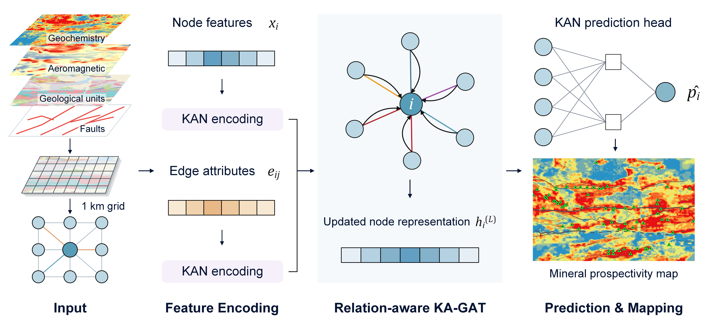
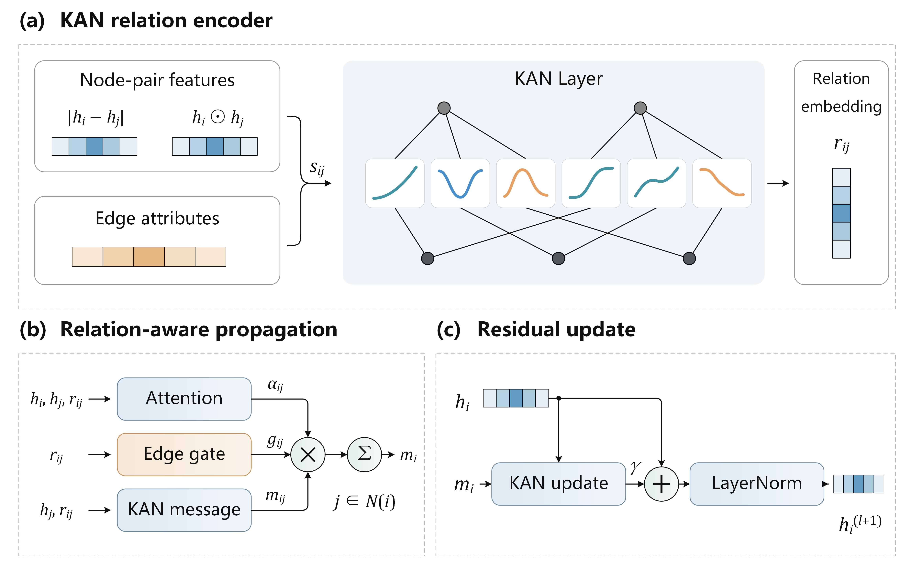

# 基于 GeoKA-GNN 的成矿远景预测

[English](README.md)

面向保密找矿数据的公开方法代码：提供地球化学预处理、中心分组的三折交叉验证、
空间候选图，以及**距离、沿断层、跨断层、同一火成岩体**关系驱动的 GeoKA-GNN。
数据所有者在本地接入自己的数据；仓库不包含原始研究数据、真实样本坐标表、权重或数值实验结果文件。

## 模型架构

**整体框架。** 多源地学特征与空间、地质关系共同输入GeoKA-GNN，用于成矿远景预测。



**KAN关系编码与传播。** 节点对特征和边属性经过关系编码、注意力计算、门控消息聚合及残差更新。



## 安装与人工数据演示

使用 Python 3.11 及以上版本，在独立环境和项目根目录中执行：

```bash
python -m pip install -e .
python -m relation_kagat.cli demo --work outputs/demo --epochs 3
python -B -m unittest discover -s tests -v
```

演示会在本地生成完全人工的数据，实际运行三折训练及最终重训；再次演示时使用新的输出目录。
默认使用 CPU。安装适配的 CUDA 版 PyTorch 后，可设置 `training.device: cuda`。
演示不执行地图发布验收。人工输入与原源码的数值对照见[验证记录](docs/VALIDATION.md)。

## 接入自己的数据

复制 `configs/default.yaml` 为 `configs/private.local.yaml`，按[输入约定](docs/INPUTS.zh-CN.md)
准备节点表、米制网格和带 CRS 的地质几何文件。配置内的相对路径以配置文件目录为基准。

```bash
python -m relation_kagat.cli prepare --config configs/private.local.yaml
python -m relation_kagat.cli cross-validate --config configs/private.local.yaml
python -m relation_kagat.cli train --config configs/private.local.yaml
python -m relation_kagat.cli predict --config configs/private.local.yaml
```

`train` 会自动执行或复用已完成且校验一致的三折验证，因此也可省略单独的 `cross-validate` 命令。
准备数据、交叉验证及最终权重均绑定联合关系编码和OOF阈值选择协议，需要使用新的运行目录。
旧关系通道模型的缓存和权重不能直接载入。

## 数据预处理与三折验证

- 原始化探先在采样点上做 CLR，再逐元素进行 IDW。缺失哨兵转为 NaN；非正值按显式的
  `half_min_positive` 策略替换。部分缺失行按已观测组分计算 CLR，缺失项继续保留。
- IDW 使用幂次2、最多12个邻点：先在2 km内要求至少3点，不足时扩大到5 km仍要求至少3点。
  无足够支撑时保留 NaN，不使用最近点兜底。参数位于 `preprocessing`，通过
  `interpolate_assays` 辅助函数使用；`prepare` 从已插值、对齐的节点表开始。
- 每个训练折独立拟合中位数、IQR及类别词表。IQR不足时回退训练折标准差，再回退1。
  连续缺失值标准化后置0；保留化探缺失比例、化探完整可用标志及航磁缺失标志三列。
- 先划分独立中心，再扩展本格及八邻格。3×3扩展会重叠的正中心绑定为同一组。
  背景中心在全部已知正中心3 km以外抽取，中心间切比雪夫间隔至少3格，扩展块不得重叠。
  固定种子137，中心级正背景比1:1，保存 `samples.json`，不按模型成绩更换样本。
- 外层测试中心按配置比例固定留出；开发集正中心按重叠组分配至三个近似平衡的验证折，
  背景中心采用固定种子的三折 KFold。每个开发节点恰好验证一次，测试节点不进入任何开发折。
- 三折各自按验证 AUC选择检查点；取最佳训练轮数中位数并四舍五入，在全部开发样本上重新训练。
  合并三个验证折的OOF原始分数，以Youden指数最大化确定分类阈值，即最大化灵敏度与特异度之和减1。
  并列时取较高的有限阈值，分类规则为原始分数大于或等于该阈值。阈值在最终重训前锁定并随权重保存，
  最终模型只评估一次外层测试集，测试标签不参与阈值选择。

这是传导式图学习：验证和测试节点的无标签特征与空间连接保留，标签不参与相应训练。
原项目的中心分组和预处理算法已迁移；公开配置中的特征名称及可调训练超参数由使用者按数据设置。

## 四种空间与地质关系

边属性顺序固定为 `[normalized_distance, same_igneous_body, along_fault, cross_fault]`。
仅在1.5 km半径内生成双向候选边，地质关系标注已有边，不新增长距离连接。

|关系|规则|
|---|---|
|距离|两端米制欧氏距离除以候选半径|
|同一火成岩体 Same|两端严格位于同一岩体面部件内部，且整条连线被该面覆盖；边界点不算内部|
|沿断层 Along|两端距同一实测断层部件均不超过1 km；两端局部切向与边方向的余弦平方均至少0.5；沿线投影间距不超过2 km；连线不得穿过该断层|
|跨断层 Cross|连线对任一实测断层满足 `crosses`；仅接触端点或沿线重合不算穿越|

Along取两端余弦平方的较小值，乘以 `exp(-(d_i+d_j)/2000)`；多条断层取最大值。
局部切向由投影点前后各500 m的位置确定。标为推测的断层不参与Along或Cross。
同一火成岩体按实际多边形判定，不按粗略岩性类别或同地层年代代替。

模型按论文Section 2.3进行统一关系编码和消息聚合。节点对的绝对特征差、逐元素积与完整四维边属性
拼接后，经两层KAN生成一个关系表示。该表示同时参与节点注意力、Edge-KAN软门控及邻居消息变换，
按注意力与门控乘积加权求和，再经KAN更新、节点残差相加及LayerNorm得到更新后的节点表示。
节点编码、关系编码各含两层KAN，加上边门控、消息、更新和预测头，共八个KAN模块。
默认dropout为0.3、隐藏维度16、注意力头2、KAN网格3及三次样条；全部参数见配置。

## 输出和公开检查

运行目录保存每折预处理、三份交叉验证权重、OOF分数、Youden阈值选择记录、折均值和标准差、最终权重及测试指标。
样本、输入、预处理、CV产物与最终检查点通过SHA-256绑定，配置变化需要新的运行目录。

`predict` 先验收全区原始分数，再导出面积百分位图，重新打开GeoTIFF读取实际值。
独立CSV/JSON包含 `min、P05、P25、median、P75、P90、P95、max` 及 `>=0.5、>=0.8、>=0.9`
的有效面积比例。失败状态为 `failed`，仅地图验收通过后才写 `complete`。

**背景样本不是已证实无矿；sigmoid分数和面积百分位都不是校准后的成矿发生概率。**
原分数不通过时应排查原因，不能用排名或更换背景样本掩盖问题。

在干净的源码副本中执行：

```bash
python -B tools/check_public_tree.py
```

数据、几何、演示输出和权重留在本地。作者、论文引用及许可证由权利人正式发布时补充。
